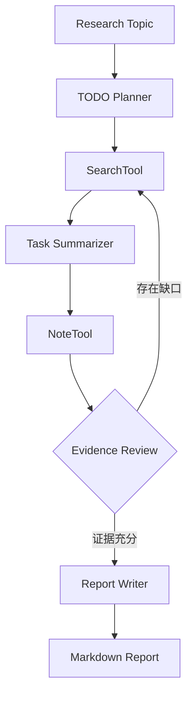

# Deep Research Agent

一个将通用大模型能力封装成**可规划、可追溯、可继续**研究工作流的多智能体项目。

它不是为了替代 ChatGPT、Codex 或豆包，而是验证如何把一次性的深度研究能力产品化：将复杂课题拆成任务，执行联网检索，沉淀带来源的研究笔记，检查证据缺口，最终生成可回溯报告。

[在线作品集](https://jiayu-deep-research-portfolio.hujy-0525.chatgpt.site) · [公开演示工作台](https://jiayu-deep-research-portfolio.hujy-0525.chatgpt.site/demo)

## 为什么做这个项目

通用聊天产品适合临时提问和开放探索；当研究需要重复执行、正式交付、证据审核和中断恢复时，还需要模型之外的工作流层：

- 显式任务规划，而不是把研究过程隐藏在单轮回答中；
- 来源、任务笔记和最终报告逐层对应；
- 支持暂停、续研、历史记录和 Markdown 导出；
- 可以分别评估规划、检索、总结和报告质量；
- 可以接入特定业务规则、知识库与审核节点。

如果只是个人偶尔完成一次研究，直接使用成熟平台通常更省钱、更高效。本项目聚焦的是垂直工作流与产品化能力，而不是宣称底层模型更聪明。

## 工作流



## 核心能力

- **TODO Planner**：将主题拆解为 3–5 个互补、可搜索验证的子任务。
- **SearchTool**：通过 OpenAI Responses Web Search 获取可追溯来源。
- **Task Summarizer**：围绕任务目标提炼核心观点、关键数据与证据局限。
- **NoteTool**：保存结构化研究笔记及其来源编号。
- **Evidence Review**：检查证据缺口，必要时生成补充任务。
- **Report Writer**：只使用已经沉淀的笔记生成最终报告和参考文献。

## 界面与交互

- 紫蓝色研究启动页；
- 左侧课题、进度和历史记录；
- 中间任务列表、质量门、Agent 状态和 SSE 日志；
- 右侧来源、研究笔记与最终报告；
- 暂停、继续和 Markdown 导出。

## 技术实现

- JavaScript / ES Modules
- Cloudflare Worker-compatible runtime
- OpenAI Responses API + Web Search
- Server-Sent Events 实时进度
- R2-compatible object storage
- Node.js built-in test runner

项目采用顺序协作而非无限制的 Agent 自由对话，便于控制成本、定位失败步骤、恢复任务和解释执行状态。

## 本地运行

```bash
npm run dev
```

浏览器打开 `http://localhost:4173`。本地开发服务器使用预置演示数据，不会调用 OpenAI API。

## 构建与测试

```bash
npm run build
npm test
```

测试覆盖：

1. 静态工作台与受保护 API；
2. Planner → Search → Summarizer → Note → Reflection → Report 完整 SSE 链路；
3. 架构状态接口；
4. 旧研究记录兼容迁移与用户隔离。

## 生产配置

复制 `.env.example` 中的变量名，在部署平台配置服务端 Secret。不要把真实值写入文件或前端代码。

- `OPENAI_API_KEY`：仅服务端可读；
- `OPENAI_MODEL`：可选，需替换为账户实际可用模型；
- `BUCKET`：R2 或兼容对象存储绑定。

`.openai/hosting.json` 不包含真实项目 ID 或生产存储名称。

## 隐私说明

公开仓库不包含 API Key、Token、生产部署 ID、用户研究记录、个人聊天或简历材料。公开演示工作台使用固定示例数据，与真实生产数据完全隔离。更详细的要求见 [SECURITY.md](SECURITY.md)。

## 项目结构

```text
web/                 前端工作台
worker/              API、Agent 编排与存储逻辑
scripts/             构建及本地演示服务
test.mjs             端到端工作流测试
.github/workflows/   持续集成
```

## 作者

胡嘉育 · AI 产品经理 / Vibe Coding 实践者

项目重点展示从需求定义、产品设计、Agent 架构到前后端实现、验证和部署的完整闭环。
